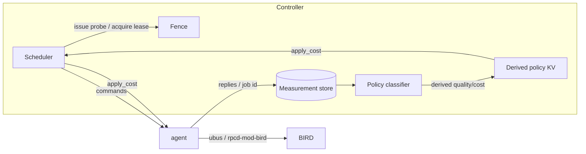

# Architecture

Mielofon is a distributed QoE (link-quality) coordination layer for an OSPF
mesh running over AmneziaWG point-to-point links. It steers traffic to good
links and away from degraded ones, and gives an operator a per-link and path
view of why traffic goes where it goes.

This document describes the controller (`crates/controller`) and the agent
(`crates/agent`, packaged as `mielofon-agent/`). Both are Rust and share the
wire types in `crates/mielofon-proto`.

> **Sanitization**: this is a public repo describing software for a private
> mesh. Only placeholder node names (`hub-a`..`hub-e`) and RFC-private
> documentation addresses are used.

## Repository

The repo is both the mielofon source **and** an OpenWrt feed. In `feeds.conf`:

```
src-git mielofon https://github.com/vooon/mielofon-qoed.git
```

- `crates/` — Rust workspace source (`controller`, `agent`, `mielofon-proto`,
  `mielofon-otel`).
- `mielofon-controller/` and `mielofon-agent/` — feed `Package/` definitions.
- OpenWrt's feed scanner ignores non-package directories (e.g. `crates/`).

## Controller

A small asynchronous Rust daemon (tokio + axum + rustls) forming a multi-node
cluster. Runs on a small set of nodes (all voters). The fabric between nodes is
the operator WAN/public network, **not** the mesh underlay, so coordination and
probing stay off the links being measured.

### Consistency

**Eventual** via gossip / anti-entropy with a last-write-wins (LWW) per-link
store. Full linearizable consensus is not required. A node joining/leaving is
handled by membership in the config; a lost node's records age out via the
store's expiry (`grace_ttl_secs`).

### Listeners

| Listener | Port | Transport | Purpose |
|----------|------|-----------|---------|
| members  | 9551 | mTLS (rustls) | cluster gossip / anti-entropy |
| clients  | 9552 | mTLS (rustls) | agents: commands + replies (long-poll) |
| admin    | 9553 | HTTP on loopback | dashboard `/`, `/metrics`, `/healthz`, `/readyz`, read endpoints |

The admin listener binds `127.0.0.1` and is intended to be exposed through a
reverse proxy (e.g. HAProxy). It is **not** mTLS; the proxy is the exposure
boundary.

### Coordination model

The controller is the **decision-maker** for the whole mesh. Two background loops
run inside each controller, decoupling measurement from decision:

1. **Measurement**: probe reports are appended to the replicated time-series
   store (`tsdb`). No classification happens at ingest.
2. **Policy classifier**: a loop re-derives each link's quality class and OSPF
   cost from a *window* of stored samples (per-dimension freshness, with the
   sparse throughput dimension carried for a longer window), and writes the
   derived record to the LWW KV. A member classifies only the links of its
   own registered agents (the reverse half of a tunnel owned elsewhere is
   available through the replicated samples), so each derived record has a
   single writer cluster-wide.
3. **Scheduler** issues per-link always-on probe work on a cadence, and gated
   throughput probe work only when the link's fence lease is free (acquiring
   the lease itself before dispatch).
4. The scheduler dispatches `apply_cost` commands when the derived cost differs
   from what an agent last applied.

Because decisions come from the replicated store (a window, not the latest
datapoint), a sparse probe — the gated TCP-throughput probe, skipped while a
link is busy — no longer blanks that dimension from classification: the last
measured value is carried within its freshness window. Measurement and policy
are thus independent; the store is the single source of truth.



The agent is a **thin executor** (Rust, tokio): it long-polls the controller's
command endpoint, answers each command with raw measurements (echoing the job
id), and applies the OSPF cost it is told to apply. It holds no scheduling,
policy, or classification logic, and never acquires the fence itself. Spokes
sit behind NAT, so agents pull work from the controller rather than the
controller connecting out to them. A controller that does not know the agent
(restart, eviction after 300 s without a poll) answers the poll with `404`
and the agent registers again; applied costs live in BIRD's runtime config,
so every registration re-seeds them.

The agent package (`mielofon-agent/`) installs `/usr/sbin/mielofon-agent`, a
procd init and a UCI config (`/etc/config/mielofon-agent`) that carries the
mTLS identity (`/etc/mielofon/agent.{key,cer}` + `ca.pem`) and a single
`controller_url`. Key integration points:

- **Transport**: mTLS HTTPS (hyper + rustls with the ring provider), pinned to
  the mesh CA, same certificate files as the controller's clients listener.
- **Discovery** (`docs/link-autodiscovery.md`): `bird status` and
  `network.interface.<iface> status` over ubus, re-run every 30 s; a changed
  link set triggers a re-register.
- **Measurement** is in-process. Each managed link has a ping task on a raw
  ICMPv6 socket bound to the tunnel /127; rtt (mean), jitter (stddev) and loss
  come from a rolling window, with RTT taken from the kernel receive timestamp
  (`SO_TIMESTAMPNS`). The gated throughput test runs `iperf3 -J` (the node's
  upload to the peer's `iperf3-server`) as a child process, one at a time,
  skipped while the link carries more than `quiet_max_mbps`; pings pause
  during the test and a short grace after it, so its self-inflicted queueing
  is never recorded.
- **BIRD** is driven through
  [rpcd-mod-bird](https://github.com/vooon/my-openwrt-feed/tree/master/rpcd-mod-bird)
  (`set_ospf_cost`, `route`). All ubus calls run the `ubus` CLI: they are
  infrequent, and it keeps the agent free of a libubus binding.

### Probe fence (soft lease)

The fence is owned entirely by the controller scheduler. A lease has a TTL and
token, is keyed by directed link, and the controller releases it when the
corresponding reply arrives (or at once, when the command could not be
queued). The agent itself runs one throughput test at a time per node and
skips the test while the link carries traffic above `quiet_max_mbps`.

> Known limitation: the fence lives per controller process (in-memory) and
> per directed link. The two halves of a tunnel, owned by agents registered
> at different members, can therefore test at the same time; the utilisation
> gate catches most overlaps, the rest are tolerated (eventual consistency)
> and reported as `conflict`. Moving the lease into the replicated gossip
> store so the fence is truly cluster-global is a future step.

### Quality classification

The controller maps reported metrics to `good` / `acceptable` / `poor` / `bad`
using conservative thresholds, and derives a per-link OSPF cost. The controller
**never** writes a dead/broken state — hard outages are owned by the underlay's
dead-interval so the no-controller state is safe. Importantly, a low-RTT link
that is throughput-throttled is still penalised (the key failure mode active
probes must catch).

OSPF cost is per direction: each side sets it on its own outgoing interface.
The two directed halves of a tunnel (`A→B`, `B→A`) are therefore classified
together (`[classifier] pair_cost`). Rtt, loss and jitter come from ICMP echo,
so both ends measure the same round trip and a pair always uses the worse
value of the two. Throughput is the only truly directional dimension (each
side's iperf measures its own upload): in `directional` mode (the default)
each half keeps its own, so the halves only get different costs under real
one-way shaping; `symmetric` uses the worse of both so the costs are always
equal. Halves are matched by swapped node names, so only when exactly one
tunnel exists between two nodes; anything else is classified on its own.

### Lockdown rules

- mTLS on members + clients, verified against a dedicated CA; no anonymous
  endpoints.
- The CA private key lives on the operator's control plane, not on any node.
- The admin listener is loopback-only plus whatever the proxy is configured to
  expose.

## Observability

Two paths coexist on the admin listener / via OTLP:

- **Prometheus scrape**: `/metrics` on the admin listener serves per-link gauges
  and a reports counter in text exposition format.
- **OpenTelemetry, OTLP/HTTP (gRPC-free)**: traces, logs, and metrics are
  exported to a collector configured under `[otel]`. The
  `opentelemetry-otlp` `grpc-tonic` feature is deliberately not enabled, so no
  gRPC is pulled into the static binary. Configuration mirrors the shape used
  by `pathosd`.

See `crates/mielofon-otel` for the shared telemetry setup.

## Non-goals

- Long-term metric archival (the live store + dashboard is the target).
- Automating real certificate distribution.

## Layout

```
crates/controller/src/
  main.rs        entrypoint: three listeners, background gossip + prune
  clock.rs       wall-clock helper
  config.rs      TOML config (node, members, listeners, tls, quality, otel)
  tls.rs         rustls mTLS (server + client) built from a pinned CA
  state.rs       shared AppState
  store.rs       measurement-store envelope (trait: append/query/window/gossip)
  tsdb.rs        embedded redb-backed ring store implementing `Store`
  kv.rs          LWW per-link store (holds *derived* policy records)
  classifier.rs  background loop: window -> quality/cost -> derived KV
  model.rs       Link, QualityRecord, Quality, ProbeState
  scheduler.rs   per-tick probe/apply dispatch, agent eviction
  worker.rs      agent registry + per-agent work queues
  fence.rs       soft-lease probe mutex
  quality.rs     classification + OSPF cost derivation (window-aware)
  api.rs         axum handlers and routers for the three listeners
  gossip.rs      anti-entropy exchange + periodic push loop
  remote.rs      minimal mTLS HTTPS client for gossip pushes
```

```
crates/agent/src/
  main.rs        entrypoint: register, command long-poll, reply dispatch
  agent.rs       link state + command execution (probe/apply_cost/trace)
  config.rs      UCI config via `ubus call uci get`
  bus.rs         `ubus` CLI wrapper (trait, faked in tests)
  discover.rs    BIRD/OSPF link auto-discovery
  icmp.rs        per-link ICMPv6 ping tasks, kernel RX timestamps
  window.rs      rolling rtt/jitter/loss statistics
  throughput.rs  gated `iperf3 -J` upload test + utilisation sample
  bird.rs        rpcd-mod-bird `set_ospf_cost` / `route`
  client.rs      mTLS JSON client to the controller
  metrics.rs     Prometheus textfile
crates/mielofon-proto/src/lib.rs   wire types shared with the controller
```
