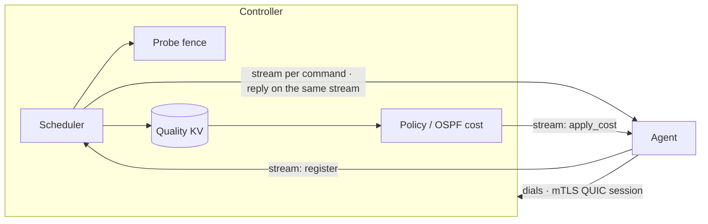

# Protocol

Wiring between the controller, agents, and cluster members. Agents hold an
mTLS **QUIC session** on the controller's **client** listener (`9552/udp`);
every message on it is a JSON frame on a stream. Members gossip over mTLS
HTTP on the **cluster** listener (`9551/tcp`); the read endpoints on the
**admin** listener (`9553/tcp`) are loopback HTTP.

## Division of responsibilities

The **controller is the decision-maker** for the whole mesh: it schedules probe
work, holds the probe fence, classifies quality, derives the OSPF cost policy,
and dispatches commands to agents.

The **agent is a thin executor**: it answers a probe command from its
continuous per-link ping window (or runs the gated throughput test), reports
raw measurements, and applies the OSPF cost it is told to apply. It holds **no** scheduling, policy, or
classification logic and never acquires the fence itself.

Spokes sit behind NAT, so the **agent dials** the controller and keeps one
session; the controller never connects out. Once the session is up either
side opens streams on it: the agent for its `register` hello, the controller
for every command. **A request is a stream**: the opener writes one frame and
closes its send side, the other end answers with one frame and closes. There
is no job queue and no polling; correlation, cancellation and deadlines are
the stream's. Every command still carries a job `id`, echoed in its reply,
for logs and traces.



## Transport

- **Carrier**: QUIC (`quinn` over `rustls`, ring), ALPN `mielofon/1`. TLS 1.3
  mutual authentication against the mesh CA: the controller demands a client
  certificate, the agent verifies the server name it dialled (a DNS name or
  the literal address, so hub certificates carry both as SANs). Keepalive
  every 15 s holds NAT bindings; a peer silent for 60 s is gone.
- **Frames**: a big-endian `u32` length, then JSON of a `mielofon-proto` type.
- **Endpoints**: the agent's `list endpoint` entries (`host:port`, names or
  literal addresses, port default 9552). Every entry is resolved to all its
  addresses, duplicates dropped, and the agent dials them in order with a
  3 s budget each, starting from the address its last session used. One
  DNS name answering with every hub and a list of literal addresses are the
  same thing to it. Control rides the **underlay**: endpoints are never mesh
  addresses, so a cost change or a dead tunnel cannot take the control
  channel with it.
- **Session = registration**: the session closing, for any reason, evicts
  the agent at once; reconnecting registers it again. A second session for
  the same agent name supersedes the first, which is closed.
- **Carrier abstraction**: the code above the carrier sees only "open a
  stream, accept a stream" (`mielofon-transport::Session`), so a TCP carrier
  (TLS 1.3 on 443 with a stream multiplexer) can be added for networks that
  drop UDP without touching the protocol.

## Quality record

A directed link `{from, to, interface}` maps to a measurement record:

```json
{
  "ts": 1747000000,
  "rtt_ms": 15.0,
  "loss_pct": 0.0,
  "jitter_ms": 2.5,
  "tcp_mbps": 1.5,
  "udp_mbps": 19.5,
  "udp_jitter_ms": 1.2,
  "udp_loss_pct": 0.5,
  "util_mbps": 0.0,
  "state": "quiet",
  "quality": "poor",
  "ospf_cost": 50
}
```

`state` is `quiet` | `busy` | `conflict`. `quality`
(`good|acceptable|poor|bad`) and `ospf_cost` are assigned by the controller.

## Agent lifecycle

### Register (the hello)

The first stream an agent opens carries `register`; the controller closes a
session that sends nothing within 10 s. The same request is repeated on the
live session whenever the agent's link set changes.

```jsonc
// agent → controller, one stream
{ "type": "register", "agent": "spoke-1",
  "links": [ {"from":"spoke-1","to":"hub-a","interface":"awg_hub_a"} ],
  "loopback": "fd00:0:0:1::1" }   // mesh loopback (dummy_awg), for /v1/trace
// ← { "ok": true }                // or { "ok": false, "error": "…" }
```

`loopback` is the agent's global IPv6 on `dummy_awg` (the mesh loopback). The
controller stores it per node and uses it to resolve a destination *node name*
into the prefix the trace walker asks each hop's BIRD to resolve.

Every `register` replaces the agent's link set and forgets which costs were
sent: the controller then opens an `apply_cost` stream for every link with a
known cost (the policy snapshot), since a re-registering agent may have
rebooted and lost its applied costs.

### Trace

```jsonc
{ "id": "trace2f4e…", "type": "trace", "target": "fd00:0:0:1::3" }
```

The controller asks a hop agent to resolve `target` against BIRD:
`ubus call bird route {prefix}` (rpcd-mod-bird ≥ 0.5.0). The reply passes the
route resolution through untouched — the controller owns ECMP parsing.

```jsonc
{ "id": "trace2f4e…", "kind": "trace",
  "prefix": "fd00:0:0:1::3",
  "code": 0,                      // 0 ok, 1 unresolved, 2 bad args
  "routes": [ {
      "prefix": "fd00:0:0:1::3/128", "primary": "via",
      "proto": "ospf3", "preference": 150, "cost": 10,
      "next_hops": [
        { "kind": "via", "addr": "fd00:0:0:1::0:2", "iface": "awg_hub_a", "cost": 10 },
        { "kind": "dev", "iface": "dummy_awg", "cost": 0 }   // destination reached
      ] } ] }
```

- `kind: via` — the hop is reachable out `iface`; the controller resolves the
  peer from the hop's registered links (`interface` is the *from* side, matching
  BIRD's egress), continues the walk, and annotates the edge with the link's
  KV measurement.
- `kind: dev` on the destination's own loopback — branch terminated (reached).
- `code: 1` / empty `routes` (older rpcd, no `route` method) — unresolvable
  hop: marked broken, the walk keeps going on the other ECMP branches.

### Commands

The controller opens one stream per command on the agent's session and reads
the reply on it. Each command carries a job `id`:

```jsonc
{ "id": "always/spoke-1/…", "type": "probe", "tier": "always",
  "link": { "from":"spoke-1","to":"hub-a","interface":"awg_hub_a" } }

{ "id": "throughput/spoke-1/…", "type": "probe", "tier": "throughput",
  "token": "6e4a…",                    // fence lease held by the controller
  "link": { … } }

{ "id": "apply/spoke-1/…", "type": "apply_cost",
  "link": { … }, "cost": 50 }
```

The controller's scheduler issues `probe/always` per link on an interval, and
`probe/throughput` only when neither endpoint of the link is in another test
— it acquires the node-level fence lease before issuing the command, so tests
on disjoint node pairs run concurrently. `apply_cost` is issued when the
derived cost for a link differs from the last cost the controller told the
agent to apply. At most one command per (link, kind) is outstanding: while
one is in flight the scheduler leaves that link alone, so a slow agent never
accumulates a backlog. Each command has a deadline (30 s for an always probe,
120 s for a throughput test, 60 s for a cost apply, 30 s for a trace hop);
a command that produced no reply by then — the stream failed, the session
dropped, or the agent closed the stream without answering — is treated as
failed: a throughput lease is released at once, a cost apply is retried
after 30 s.

### Reply

Written on the command's own stream; every reply echoes the job `id`:

```jsonc
{ "id": "always/spoke-1/…", "kind": "probe",
  "link": { … },
  "rtt_ms":15.0, "loss_pct":0.0, "jitter_ms":2.5,
  "tcp_mbps":null, "util_mbps":0.0, "state":"quiet", "token": null }

{ "id": "apply/spoke-1/…", "kind": "applied", "link": { … }, "cost": 50,
  "note": "bird returned code 3" }   // note only when the cost was NOT applied
```

- Always-on replies carry no token. Throughput replies echo the fence token
  from the command; the controller releases the lease on receipt. They carry
  the TCP upload (`tcp_mbps`) and, when the agent's `udp_rate_mbps` is set,
  the UDP leg (`udp_mbps`, `udp_jitter_ms`, `udp_loss_pct`: what the peer
  received from a fixed-rate stream, the raw path without TCP's congestion
  control). The classifier uses the UDP dimensions only where a class pins a
  threshold for them.
- Always-on probes always send what they measured and report `rtt_ms`/`loss_pct`/
  `jitter_ms` as `null` when they could not measure (a failed ping must not turn
  into a fake loss or a fake jitter — an unmeasured dimension never constrains
  classification). Throughput replies echo the agent's **last always-on
  measurement** for those fields so they stay populated across fence-gated runs.
  The controller stores reports verbatim — no history carry-forward.
- A busy link is reported `state: "busy"` (with `util_mbps`) and is never
  classified as degraded. Always-on replies carry the utilisation since the
  previous probe, so a link in use is busy on every tier.
- A probe that could not measure (iperf3 failed, unknown interface) adds a
  `note`; the dimensions stay `null`. The controller logs it and counts it in
  `mielofon_probe_failures_total`.
- An `applied` reply with a `note` is a failure: the controller forgets the
  cost was sent and re-issues it after 30 s.
- A cost applied without a `note` becomes the agent's desired cost for that
  link: the agent re-applies it on its own whenever its periodic BIRD
  snapshot shows the interface at a different cost (a config redeploy reset
  it), so the controller's "already sent" memory stays true.
- `POST /v1/quality` on the **admin** listener (same body as a probe reply
  minus `kind`/`id`) ingests a bare measurement for tooling and the e2e
  harness; `mielofon-controller tool hello` registers a synthetic agent over
  a real session for the same purpose.

## Fence (soft lease)

Owned entirely by the controller scheduler. A lease has a TTL and token and
occupies both endpoints of its link (a node runs one iperf3 client and serves
one iperf3 server at a time, in either role); on expiry without a report it
may be re-issued. An overlapping throughput probe is tolerated and reported
as `conflict`.

## Read endpoints (admin listener)

```text
GET /v1/quality?from=..&to=..&interface=..   latest record for a link
POST /v1/quality                             ingest a bare measurement (tooling)
GET /v1/quality/all                          full replicated view
GET /v1/policy?from=..&to=..&interface=..    quality + ospf_cost decision
GET /v1/trace?from=..&to=..                  ECMP-aware end-to-end path DAG
GET /v1/ts?from=..&to=..&interface=..        per-link time-series history
GET /v1/status                               node, readiness, leases, agents
GET /healthz                                 200 when process is up
GET /readyz                                  200 when ready, 503 otherwise
GET /metrics                                 Prometheus text exposition
```

## Time-series history (TSDB)

Every ingested report is appended to a per-link time-series: a raw sample
(always probes every 15 s, throughput every 300 s) plus a 60 s aggregate
bucket (min/avg/max per dimension). Two reports in the same second are merged
dimension-wise. Raw samples are **replicated** between cluster members
through the gossip exchange (each push carries the fresh samples since the
per-peer watermark, which only advances once the peer answered; idempotent
on the receiver); buckets are a local rollup and are not gossiped. History is kept in-memory (raw
`raw_retention_secs`, buckets `agg_retention_secs`) and, when `[ts] path` is
set, durably mirrored to an embedded redb file flushed in batches.

```jsonc
GET /v1/ts?from=spoke-1&to=hub-a&interface=awg_hub_a&since=1746996000&until=1746999600
// raw (within retention) + 60s buckets:
{ "link": { "from": "spoke-1", "to": "hub-a", "interface": "awg_hub_a" },
  "since": 1746996000, "until": 1746999600,
  "samples": [ { "ts": 1746996000, "rtt_ms": 11.5, "loss_pct": 0.0, "jitter_ms": 1.8, "util_mbps": 0.0, "state": 0 } ],
  "buckets": [ { "ts": 1746996000, "n": 4,
                 "rtt": { "n": 4, "min": 9.8, "avg": 11.2, "max": 13.4 }, "util": { "n": 4, "min": 0, "avg": 0, "max": 0 } } ] }
```

Defaults: `since` = `until - 3600`, `until` = now. A failed measurement is
recorded as an unset (`null`) dimension, never a fake `0`/`-1`. Busy/conflict
samples are included with their `state` code (0 quiet, 1 busy, 2 conflict).

`GET /v1/trace?from=spoke-1&to=node-z` walks the mesh from the `from` agent
to the destination node's registered mesh loopback (a raw `prefix=` overrides
name resolution). The response is a BFS over every route's `next_hops` —
equal-cost branches are kept (a DAG), one `edges` row per traversed edge:

```jsonc
{ "from": "spoke-1", "to": "node-z", "prefix": "fd00:0:0:1::3",
  "ts": 1747000000, "complete": true, "cap_hit": false,
  "edges": [ { "depth": 0, "node": "spoke-1", "iface": "awg_hub_a", "to": "hub-a", "rtt_ms": 12.0,
               "loss_pct": 0.0, "quality": "good", "ospf_cost": 10, "broken": false },
             { "depth": 1, "node": "hub-a", "iface": "awg_hub_b", "to": "hub-b", … },
             { "depth": 2, "node": "hub-b", "iface": "dummy_awg", "term": true, "broken": false } ] }
```

`term` marks "destination reached" (`dev` on the target's own loopback);
`broken` marks conflict/bad/missing-quality edges, dead-ends (no route), hop
timeouts, or the hop-cap cut. Results are TTL-cached ~5 s for the map page's
auto-refresh.

## Gossip (anti-entropy)

Members exchange the full KV view. LWW merge keeps the newest `ts` per link;
records older than `grace_ttl_secs` expire. Each member derives policy only
for links of its own registered agents, so every derived record has one
writer and the merge never flaps. Pushes to all members run concurrently,
each bounded by a 10 s timeout.

```jsonc
POST /v1/gossip/exchange          // members
{ "node": "hub-a", "records": [[…]], "ts_samples": [[…]] }
// -> { "node": "hub-b", "records": […] }   // merged by the pusher
```
